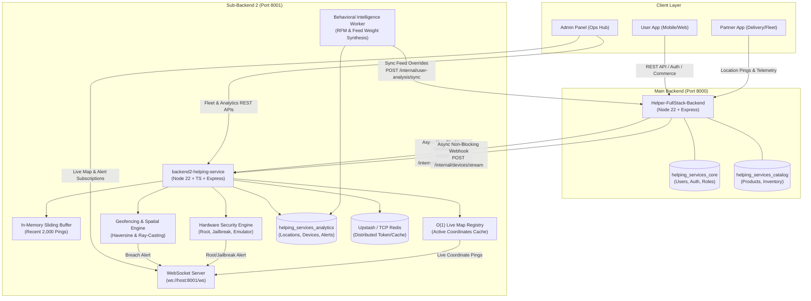
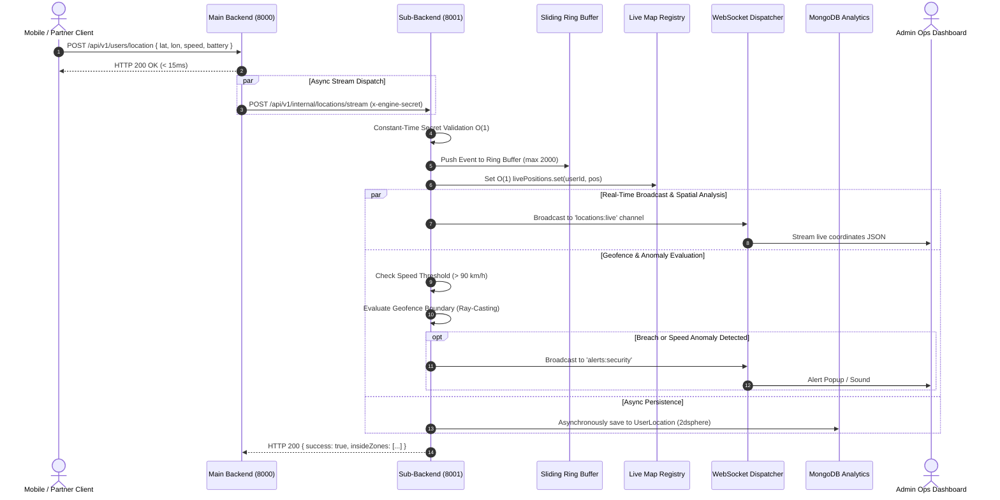
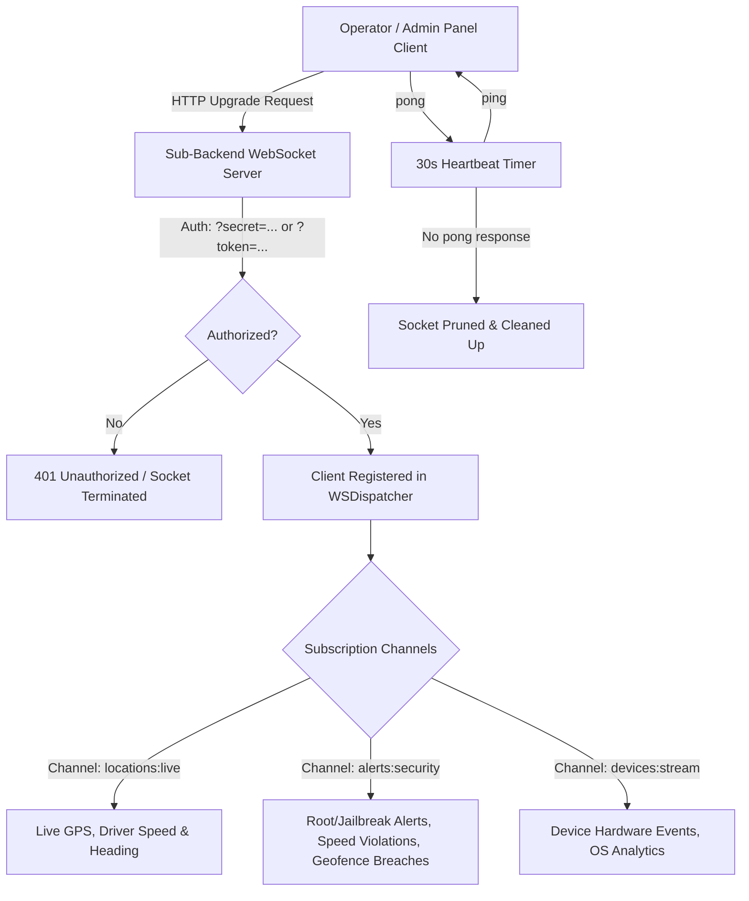

# Helping Services Sub-Backend — System Architecture (`arcitructure.md`)

This document outlines the architectural topology, component boundaries, inter-service communication protocols, and data pipelines of the **Helping Services Sub-Backend (`backend2-helping-service`)**.

---

## 1. Ecosystem Topology & Microservice Boundaries

`backend2-helping-service` is an asynchronous microservice operating alongside the **Helping Services Main Backend** (`Helper-FullStack-Backend`). It is purpose-built for real-time telemetry ingestion, live fleet dispatching, geospatial geofencing, hardware integrity detection, and user behavioral intelligence.



---

## 2. Multi-Tier Microservice Responsibility Matrix

| Domain | Helping Services Main Backend (Port 8000) | Helping Services Sub-Backend 2 (Port 8001) |
|---|---|---|
| **Identity & Access** | Registration drafts, 3-day abandonment reminders, OTP passwordless login, JWT issuance, profile updates. | Validates shared service secret (`x-engine-secret`, `x-admin-sub-backend-secret`) and operator JWT tokens. |
| **Catalog & Commerce** | Product catalog upload, pricing, SKUs, inventory, accessory cross-sell links, cart sessions. | Consumes interaction event stream to compute personalized category boosts and suppressions. |
| **Telemetry Ingestion** | Primary receiver from mobile apps; acknowledges client $< 15$ ms; asynchronously forwards event. | Ingests stream webhooks; updates in-memory sliding buffer; broadcasts via WebSocket. |
| **Geospatial & Fleet** | Stores `User.lastLocation` snapshot in Core DB for user lookup. | High-performance 2dsphere indexing, proximity search, circular/polygon geofencing, breadcrumb trajectory replay. |
| **Security & Devices** | Stores `User.lastDevice` snapshot in Core DB. | Real-time threat detection (Root, Jailbreak, Emulator abuse, GPS spoofing, low battery warnings). |
| **Real-Time Streaming** | Standard REST endpoints. | Dedicated WebSocket server (`ws`) with pub/sub channels (`locations:live`, `alerts:security`, `devices:stream`). |
| **Feed Recommendations** | Executes Algorithm 1 (Feed Ranking) and Algorithm 2 (Cart Dwell Boost) during user requests. | Computes user interest profiles, clustering tags, and feeds vectors via background worker. |

---

## 3. High-Throughput Stream Ingestion & Decoupling Pipeline

To ensure client responsiveness is never compromised by complex spatial calculations or analytics storage, the Sub-Backend employs an **asynchronous buffer decoupling pipeline**:



---

## 4. Real-Time WebSocket Pub/Sub Topology

The WebSocket server is mounted directly alongside the Express HTTP listener on `/ws` and `/api/v1/ws`.



### Pub/Sub Channel Contract

1. **`locations:live`**:
   ```json
   {
     "channel": "locations:live",
     "data": {
       "userId": "usr_94102",
       "userName": "Rohan Sharma",
       "role": "partner",
       "latitude": 22.572645,
       "longitude": 88.363892,
       "speed": 6.8,
       "speedKmph": 24.5,
       "heading": 142,
       "batteryLevel": 88,
       "insideZones": ["CAMPUS_MAIN_HUB"],
       "timestamp": "2026-11-11T13:45:00.000Z"
     }
   }
   ```

2. **`alerts:security`**:
   ```json
   {
     "channel": "alerts:security",
     "data": {
       "id": "alert_8192a01",
       "alertType": "rooted_or_jailbroken",
       "severity": "critical",
       "title": "Rooted / Jailbroken Hardware Detected",
       "description": "Device is running with elevated root privileges or compromised jailbreak environment.",
       "userId": "usr_94102",
       "role": "partner",
       "location": { "latitude": 22.5726, "longitude": 88.3639 },
       "createdAt": "2026-11-11T13:45:02.100Z"
     }
   }
   ```

3. **`devices:stream`**:
   ```json
   {
     "channel": "devices:stream",
     "data": {
       "userId": "usr_94102",
       "osName": "android",
       "osVersion": "14.0",
       "deviceBrand": "Samsung",
       "deviceModel": "Galaxy S24",
       "batteryLevel": 88,
       "networkType": "cellular_5g"
     }
   }
   ```

---

## 5. Multi-Database Architecture & 3 Interconnected Clusters

`backend2-helping-service` connects directly to **3 dedicated, interconnected MongoDB databases** (both in dedicated multi-cluster Atlas production mode and cached multi-database in-memory test mode):

```mermaid
flowchart TD
    subgraph SubBackend["Helping Services Sub-Backend 2 (Port 8001)"]
        Router["Model & Query Dispatcher"]
    end

    subgraph CoreDB["1. Core / Identity Database (helping_services_core)"]
        PartnerModel["Partner (Delivery Fleet, Ratings, Mercy Extensions)"]
        WalletModel["PartnerWallet (Virtual Balance, Cash Holds, Ledger)"]
        UserProfileModel["UserOrderProfile (Surcharges, Cancellations)"]
    end

    subgraph CatalogDB["2. Product Catalog Database (helping_services_catalog)"]
        ProductModel["Product (Catalog, ₹ Pricing, Stock, SKUs)"]
    end

    subgraph AnalyticsDB["3. Analytics & Operations Database (helping_services_analytics)"]
        OrderModel["Order (Lifecycle, Ring Delays, OTPs, 5:1 Mode)"]
        LocModel["UserLocation (Live GPS, Breadcrumbs, 2dsphere)"]
        DevModel["UserDevice (Hardware, Battery, OS Distribution)"]
        GeoModel["GeofenceZone (Polygons, Circles, Delivery Hubs)"]
        AlertModel["SecurityAlert (Spoofing, Jailbreak, Speed Alerts)"]
        ProfileModel["UserInterestProfile (Behavioral Weights, RFM)"]
        EventModel["ProductEvent (Clicks, Dwells, Cart Interactions)"]
    end

    Router -->|getCoreDb()| CoreDB
    Router -->|getCatalogDb()| CatalogDB
    Router -->|getAnalyticsDb()| AnalyticsDB
```

```
+====================================================================================================+
|                                3 INTERCONNECTED MONGODB DATABASES                                  |
+====================================================================================================+
|                                                                                                    |
|  1. CORE / IDENTITY DATABASE (helping_services_core)                                               |
|     - Connection: env.MONGODB_CORE_URL / getCoreDb()                                               |
|     - Models: Partner, PartnerWallet, UserOrderProfile                                             |
|     - Responsibilities: Fleet profile management, virtual wallet ledgers, user cancellation       |
|       surcharge states (₹0.30 penalty on 2nd offense), and identity records.                       |
|                                                                                                    |
|  2. CATALOG / COMMERCE DATABASE (helping_services_catalog)                                         |
|     - Connection: env.MONGODB_CATALOG_URL / getCatalogDb()                                         |
|     - Models: Product                                                                              |
|     - Responsibilities: Authoritative product catalog, ₹ Rupee base pricing, active stock,         |
|       discounted pricing, and SKU mappings managed via Admin panel.                                |
|                                                                                                    |
|  3. USER INTELLIGENCE, OPERATIONS & ANALYTICS DATABASE (helping_services_analytics)                |
|     - Connection: env.MONGODB_ANALYTICS_URL / getAnalyticsDb()                                     |
|     - Models: Order, UserLocation, UserDevice, GeofenceZone, SecurityAlert,                        |
|       UserInterestProfile, ProductEvent                                                            |
|     - Responsibilities: Order lifecycle dispatching, 2.5km ring partitioning, 6-digit OTP          |
|       verifications, live GPS streaming, device telemetry, speed/spoofing security alerts,         |
|       and behavioral profile syntheses.                                                            |
+====================================================================================================+
```

### Windows DNS & Local ISP Resolution Fix
To prevent connection timeouts on Windows environments and local ISPs that block or corrupt SRV DNS lookups for MongoDB Atlas clusters (`cluster0.pyawg8c.mongodb.net`, `cluster0.vmzf51i.mongodb.net`, `cluster0.3p4hb11.mongodb.net`), the Sub-Backend explicitly initializes authoritative public recursive resolvers before socket creation:
```typescript
dns.setServers(['8.8.8.8', '1.1.1.1', '8.8.4.4']);
```

### Multi-Database Connection & Testing Strategy
- **Production Multi-Cluster Mode (`isMultiCluster = true`)**:
  Creates 3 dedicated connection pools via `mongoose.createConnection(...)` with configured pool sizes (`minPoolSize: 10`, `maxPoolSize: 50`) and health probes. All three clusters connect in parallel upon startup.
- **In-Memory & Test Mode (`NODE_ENV === 'test'`)**:
  Connects to a single `MongoMemoryServer` instance and dynamically provides isolated logical database namespaces via `mongoose.connection.useDb(dbName, { useCache: true })`. This guarantees 100% automated test isolation and eliminates port collisions or external Atlas dependencies during CI/CD.
- **Background Index Synchronization (`ensureIndexes()`)**:
  Iterates across all 3 databases (`getCoreDb()`, `getCatalogDb()`, `getAnalyticsDb()`) and ensures 2dsphere, unique compound, and TTL indexes are cleanly synchronized on boot.

---

## 6. Distributed Cache Architecture (Three-Tier Fallback)

The caching system automatically degrades gracefully across three tiers:
1. **Upstash Redis REST**: Primary serverless cache via HTTPS, zero persistent open TCP sockets.
2. **TCP Redis (IORedis)**: High-performance connection-pooled Redis for local development or Docker networks.
3. **In-Memory Cache Provider**: Embedded key-value store with millisecond TTL expiry and Set support, guaranteeing full offline functionality with zero external dependencies.

---

## 7. Containerization, Kubernetes & Production Hardening

### 7.1 Container Security Standards
- **Multi-Stage Build**: Compiles TypeScript in `builder` stage; purges devDependencies and packages only `/dist` and production node_modules in `runner` stage.
- **Non-Root Execution**: Runs strictly as `USER node` (UID 1000). Root execution (UID 0) is forbidden.
- **Minimal Image Footprint**: Based on `node:22-alpine` with minimal attack surface.

### 7.2 Kubernetes Probe Specifications
- **Startup Probe**: Tolerates up to 60s for initial Atlas connection establishment.
- **Liveness Probe**: Monitored via `GET /api/v1/health`.
- **Readiness Probe**: Queries `/api/v1/health` every 5 seconds. Pods reporting degraded status are dynamically pulled from cluster traffic.

